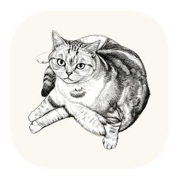
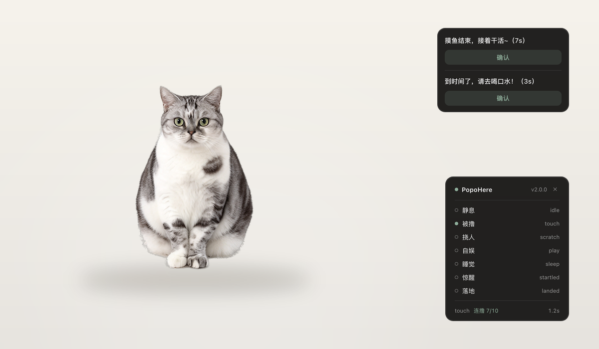

<div align="center">



# PopoHere

**一只住在你 Mac 桌面上的猫。**

用你自己的猫做一只桌宠——拍几张照片丢进文件夹，剩下交给它。

[](#安装)
[](#)
[](LICENSE)
[](#)

[下载](#安装) · [玩法](#怎么和它玩) · [自己做一只](#自己做一只) · [English](doc/README_en.md)



</div>

---

## 它是什么

PopoHere 是一个 macOS 桌面宠物。不占 Dock、不抢焦点、不联网，就静静待在你的屏幕上——
会呼吸、会溜达、会趴下睡觉，被你拎起来的时候四脚乱蹬，撸久了会翻脸。

原型是一只叫 **Popo** 的英国短毛猫（照片就是她本人）。整个项目只有 **1.2MB**，没有一行网络代码。

## 为什么不是一张会动的桌面图

| | |
|---|---|
| 🧠 **真的是个状态机** | 静息 / 被撸 / 挠人 / 自娱 / 睡觉 / 惊醒 / 落地，按猫的天性用概率流转；不是一段动画循环播到底 |
| 🖐 **拖拽跟手** | 窗口位移由原生层用**屏幕坐标**同步跟踪，不靠 JS 追光标——这里面有个经典的反馈环坑，见 [ARCHITECTURE](doc/ARCHITECTURE.md) |
| 🎲 **一个状态多张图** | 同一状态放几张素材，每次进入随机抽一张并锁定，猫不会永远保持同一个姿势 |
| ⏰ **提醒不依赖猫** | 到点弹独立小窗，**猫被隐藏、没有音频、没有动画都不影响** |
| 🪶 **零依赖** | Objective-C + 一个 WebView，通用二进制（Intel / Apple 芯片），启动不到半秒 |
| 🎨 **可以换成你的宠物** | 换图不用改代码，跑两条命令重新生成 |

## 安装

**需要 macOS 11 (Big Sur) 或更高。**

1. 到 [Releases](../../releases) 下载最新的 zip
2. 解压，把 `PopoHere.app` 拖进「应用程序」
3. 双击打开

> [!IMPORTANT]
> 这是个人项目，没有向苹果付费签名，**第一次打开会被系统拦一下**。
> 这不是中毒：**右键**（或 Control + 点击）应用图标 → 选「打开」→ 再点一次「打开」，**只需一次**，之后永久正常。
>
> 或者一行命令解决：
> ```bash
> xattr -dr com.apple.quarantine /Applications/PopoHere.app
> ```

## 怎么和它玩

| 你想做的事 | 怎么操作 |
|---|---|
| 换个地方 | 按住猫**拖动**，松手它会自己落地 |
| 撸它 | 点一下；**连着猛点 10 下**它会翻脸挠你 |
| 叫醒它 | 睡着时随便戳一下 |
| 什么都不做 | 5 秒后自己溜达，或者趴下睡觉 |
| 打开菜单 | **右键**猫，或点**菜单栏**的小猫图标 |
| 看它在干嘛 | 菜单里打开「桌宠状态」面板，还能逐个预览状态 |

位置和大小都会记住，下次打开还在原地。

## 定时提醒

右键 →「定时提醒」，三条预置：**摸鱼 25 分钟 / 喝水 45 分钟 / 久坐拉伸 60 分钟**，默认全关。

- 时间按 **1 → 5 → 10 → 15…** 调，不会出现 6、11 这种错位值
- 每条后面有 **一次 / 间隔** 开关：
  - **一次**（默认）：响过就结束，开关自动关掉，适合"提醒我一次"
  - **间隔**：按你设的间隔循环，直到你自己关掉
- 到点后在**屏幕右上角**弹出小窗：`到时间了，请去喝口水！（7s）`，点「确认」立刻关，不理它 10 秒后自动消失
- **几条同时到点会叠在一起**，先关哪条由你决定
- 猫被隐藏时照样提醒

## 自己做一只

不需要会写代码。

**① 准备照片。** 拍 8–16 张你的宠物，尽量同一机位、同一灯光。放进 `source/origin_images/`，按状态命名：

```text
source/origin_images/
├── idle_1.png        静息（同一状态多张就加序号，运行时随机抽）
├── idle_2.png
├── touch_1.png       被撸
├── scratch_1.png     不高兴
├── sleep_1.png       睡觉
├── play_1.png        自己找事做
├── dragging_1.png    被拎起来
├── logo_1.png        应用图标
└── menubar_1.png     菜单栏剪影
```

背景尽量用**纯色**（白墙、纯色地板）——预处理是语义分割，不是大模型，纯色背景下边缘最干净。
拍歪了不用重拍，写进 `orientation.json` 就能转正。完整规范见 [source/README.md](source/README.md)。

**② 跑预处理。**

```bash
pip install pillow rembg
python3 code/prepare/cutout.py --check     # 先只校验命名
python3 code/prepare/cutout.py             # 抠图 → 统一画布 → 底部对齐
python3 code/prepare/build_theme.py        # 扫文件名生成 theme.json
```

**③ 重新构建。**

```bash
./code/build/build_app.sh --run
```

`code/build/dist/PopoHere.app` 就是你的专属桌宠。

## 技术一览

```text
Objective-C 外壳（AppKit）
├── 透明无边框浮窗 + WKWebView
├── 菜单栏 NSStatusItem / 玻璃面板（NSVisualEffectView）
└── NSEvent 本地监视器 → 屏幕坐标拖拽

Web 层（无框架，原生 JS）
├── func_state    状态机（纯逻辑，不碰 DOM → 能被 Node 直接测）
├── func_render   状态 → 贴图 / 动效 / 气泡
├── func_input    命中判定、单击 vs 拖拽
└── func_menu     面板 UI

预处理（Python + rembg）
└── 抠图 → 归一化 → 同状态面积对齐 → theme.json
```

<details>
<summary><b>开发与测试</b>（点开）</summary>

```bash
# 浏览器预览（带调试面板）
python3 code/build/build_web.py && open code/build/out/preview.html

# 测试：状态机 58 · 连点 9 · 拖拽 7 · 提醒存储 16
node code/test/state_machine_test.js
python3 code/test/click_mash_test.py
python3 code/test/drag_tracking_test.py
clang -fobjc-arc -framework Foundation -I code/core/func_reminder \
  code/test/reminder_store_test.m code/core/func_reminder/PHReminder.m -o /tmp/remtest && /tmp/remtest

# 构建 / 打包
./code/build/build_app.sh
python3 code/build/package_release.py
```

接手这个项目请先读 [AGENTS.md](AGENTS.md)；设计决策与踩坑记录见 [ARCHITECTURE.md](doc/ARCHITECTURE.md)，完整需求见 [PRD](doc/PRD/PRD.md)。

</details>

## 常见问题

**猫不见了？** 菜单栏图标 →「显示 Popo」。隐藏不等于退出。

**为什么第一次打开被拦？** 没有苹果开发者签名，见上面的安装说明。

**会上传我的东西吗？** 不会。没有网络代码，不读你的文件，就是一个画猫的透明窗口。

**能用在 Windows 上吗？** 不能，这一版是 AppKit 原生外壳。

**猫的照片会进仓库吗？** 不会。仓库里只有处理后的贴图，原始照片留在本地。

---

<div align="center">

猫是真实的，代码是开源的。拿去改成你的宠物吧。

[MIT](LICENSE) · [English](doc/README_en.md)

</div>
