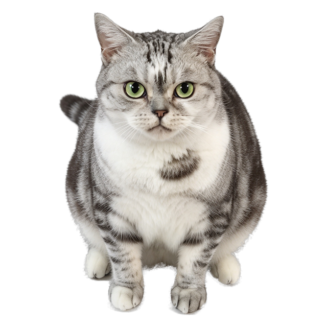

# PopoHere

> 把一只真实的猫，变成住在你桌面上的猫。

PopoHere 是一款 macOS 桌面宠物。它不占 Dock、不抢焦点，就静静待在你的屏幕上——会呼吸、会溜达、会趴下睡觉，被你拎起来的时候四脚乱蹬。

原型是一只叫 **Popo** 的英国短毛猫。**你可以换成自己的宠物**，只要几张照片。

<p align="center">
  
</p>

---

## 它有什么特别的

- **原生，但不重**——Objective-C 外壳 + 一个 WebView，整包 768KB，启动不到半秒，**零第三方依赖**
- **不联网**——没有一行网络代码，不读取任何文件，全部本地运行
- **通用二进制**——Intel 和 Apple 芯片都能跑
- **状态机驱动**——静息、自娱自乐、睡觉、被摸、炸毛、被抱起，按猫的天性用概率流转，不是一个动画循环播到底
- **拖拽跟手**——窗口位移由原生层用屏幕坐标同步跟踪，不是靠 JS 发消息追光标（这里面有个坑，见 [ARCHITECTURE.md](doc/ARCHITECTURE.md)）
- **可以换成你的宠物**——丢几张照片进 `source/origin_images/`，跑一条命令重新生成贴图

---

## 安装

**系统要求**：macOS 11 (Big Sur) 或更高。

1. 到 [Releases](../../releases) 下载最新的 zip
2. 解压，把 `PopoHere.app` 拖进「应用程序」
3. 双击打开

因为这是个人项目、没有向苹果付费签名，**第一次打开会被系统拦一下**：

> "PopoHere" 无法打开，因为来自身份不明的开发者。

这不是中毒。**右键**（或 Control + 点击）应用图标 → 选「打开」→ 再点一次「打开」，**只需这一次**，之后永久正常。

也可以一行命令解决：

```bash
xattr -dr com.apple.quarantine /Applications/PopoHere.app
```

---

## 怎么和它玩

| 动作 | 反应 |
|---|---|
| 按住拖动 | 抱起来满屏跑，松手自己落地 |
| 点上半身 | 摸头 |
| 点下半身 | 摸脚；短时间连着摸，它会生气挠你 |
| 戳睡着的它 | 惊醒 |
| 什么都不做 | 5 秒后自己溜达，或者趴下睡觉 |
| 右键 | 菜单：显示/隐藏、暂停互动、大小、退出 |

位置和大小都会记住，下次打开还在原地。

---

## 自己做一只

不需要会写代码。

**第一步：准备照片。** 拍 6–12 张你的宠物，尽量同一个角度、同一个背景光线下。放进 `source/origin_images/`，按「状态」命名：

```
source/origin_images/
├── idle.png           静息
├── idle_2.png         同一状态想要多张就加序号，运行时随机抽
├── sleep.png          睡觉
├── touch_1.png    被摸
├── touch_2.png
├── walk.png           自己溜达
├── dragging.png       被拎起来
└── ...
```

**背景尽量用纯色**（白墙、纯色地板）——预处理是语义分割不是大模型，纯色背景下边缘最干净。
完整的状态清单和命名规范见 [PRD](doc/PRD/PRD.md)。

**第二步：跑预处理。**

```bash
pip install pillow rembg      # 只需要这两个
python3 code/prepare/cutout.py
```

它会把照片抠成透明贴图、统一尺寸、底部对齐，输出到 `code/pet_images/`。

**第三步：重新构建。**

```bash
./code/build/build_app.sh --run
```

搞定。`code/build/dist/PopoHere.app` 就是你的专属桌宠。

---

## 目录结构

```
PopoHere/
├── source/                 你自己的原始素材（照片/音频）
│   ├── origin_images/
│   └── origin_audios/
├── code/
│   ├── prepare/            预处理：原始照片 → 可用贴图
│   ├── pet_images/         处理好的贴图 + theme.json（状态↔贴图的契约）
│   ├── pet_audios/
│   ├── pet_others/         图标、菜单栏 logo
│   ├── core/               桌宠本体（与造型无关，通用）
│   │   ├── func_state/       状态机（纯逻辑，无 DOM）
│   │   ├── func_render/      状态 → 贴图 / 动效
│   │   ├── func_input/       命中判定、单击 vs 拖拽
│   │   ├── func_menu/        右键菜单
│   │   └── func_window/      AppKit 外壳（窗口 / 菜单栏 / JS 桥接）
│   ├── build/              构建与打包脚本
│   ├── test/               测试
│   └── prototype/          HTML 外壳模板
├── doc/                    PRD、架构说明、DIY 指南
├── README.md
└── AGENTS.md
```

---

## 开发

```bash
# 生成预览页（浏览器里直接看，带调试面板）
python3 code/build/build_web.py
open code/build/out/preview.html

# 测试：状态机 32 条 + 拖拽 7 条
node code/test/state_machine_test.js
python3 code/test/drag_tracking_test.py

# 构建 app
./code/build/build_app.sh

# 打包发布 zip
python3 code/build/package_release.py
```

架构设计与踩坑记录见 [doc/ARCHITECTURE.md](doc/ARCHITECTURE.md)，接手项目请先读 [AGENTS.md](AGENTS.md)。

---

## License

[MIT](LICENSE)

猫是真实的，代码是开源的。拿去改成你的宠物吧。
