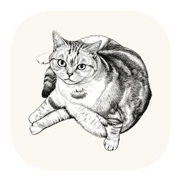
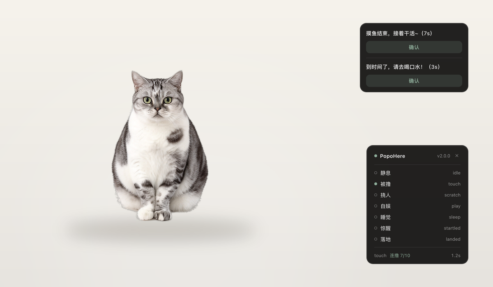

<div align="center">



# PopoHere

**Let the lovely Popo cat move into your Mac desktop~**

Let Popo be your desktop pet and little assistant. Or turn your own companion into a desktop pet — just take a few photos, drop them into a folder, and Popo handles the rest.

[](#how-to-get-it)
[](#)
[](../LICENSE)
[](#)

[How to get it](#how-to-get-it) · [How to use](#how-to-use) · [Make it your own](#make-it-your-own) · [中文](../README.md) · [MIT](../LICENSE)



<sub>Note: concept preview; the real thing looks slightly different.</sub>

</div>

---

## Who is Popo

PopoHere is a macOS desktop pet. It takes no Dock icon, never steals focus, never goes online — it just sits quietly on your screen: breathing, wandering, lying down to sleep, flailing its four paws when you pick it up, and getting annoyed if you pet it too much.

This is a lightweight desktop pet built by the developer, with the help of the large models DeepSeek V4.1-flash-1017, Hy4 preview, Seedream4.5 and Workbuddy, for their own lovely (7 kg and dieting) American Shorthair named Pocky, nicknamed Popo. Popo is a quiet, soothing soul: while we work at our desks, she quietly climbs onto her own little red plastic chair, dozes there, or simply watches us in silence. Through this small project, we hope more people can become friends with Popo.

## What makes PopoHere interesting

| | |
|---|---|
| 🧠 **A real state machine** | idle / petting / annoyed / playing / sleeping / startled / landing, with cat-like probability transitions — not one animation on repeat |
| 🖐 **Drag that keeps up** | the window is moved natively using **screen coordinates**, not by chasing the cursor from JS — there is a classic feedback-loop trap here, see the [User Guide](UserGuide_en.md#dragging-a-coordinate-system-trap-worth-knowing) |
| 🎲 **Multiple images per state** | drop several frames in a state; one is picked at random and locked until you leave and come back |
| ⏰ **Reminders don't need the cat** | a standalone popup fires even when the pet is hidden, with no audio and no animation |
| 🪶 **Zero dependencies** | Objective-C + one WebView, universal binary (Intel / Apple silicon), starts in under half a second |
| 🎨 **Swap in your own pet** | no code changes — a few commands regenerate every asset |

## How to get it

**Requires macOS 11 (Big Sur) or later.**

1. Download the latest zip from [Releases](../../releases)
2. Unzip and drag `PopoHere.app` into `/Applications`
3. Double-click to open

> [!IMPORTANT]
> This is a personal project without a paid Apple developer certificate, so **the first launch is blocked** by Gatekeeper.
> It's not malware: **right-click** (or Control-click) the app → **Open** → **Open** again. One time only.
>
> Or in a terminal:
> ```bash
> xattr -dr com.apple.quarantine /Applications/PopoHere.app
> ```

For system requirements, installation details and how to handle the warning, see [User Guide 1.1 Installation and Launch](UserGuide_en.md#11-installation-and-launch).

## How to use

**Interacting with it**

| What you want | What to do |
|---|---|
| Pet it | Click once; **10 rapid clicks** and it swipes at you |
| Move it | **Drag** the cat; let go and it lands on its own |
| Wake it | Poke it while it's asleep |
| Do nothing | After 5 seconds it wanders off or flops down |
| Open the menu | **Right-click** the cat, or click the cat icon in the **menu bar** |

**Reminders**

Right-click → **Reminders**. Three presets: **slack off 25 min / drink water 45 min / stretch 60 min**, all off by default.
Each can be set to **Once** (fires once and stops) or **Repeat** (keeps firing until you turn it off).
When due, a small panel appears in the **top-right corner**; click **Confirm** to close it, or it dismisses itself
after 10 seconds. Several reminders due together stack in one panel, and it still works while the pet is hidden.

**To-do list**

Right-click → **To-do list**. Up to 10 items of 50 characters each, check items off, clear the list at any time,
stored locally.

For the full list of controls, default values and state meanings, see [User Guide 1.3 Features](UserGuide_en.md#13-features).

## Make it your own

This project opens up its entire architecture and code: you can build on it for secondary development, or use the
current code with your own assets to build your own desktop pet — no coding required. Here are the quick steps:

**① Prepare photos.** 8–16 shots of your pet, same camera and lighting if possible. Drop them into `source/origin_images/`:

```text
source/origin_images/
├── idle_1.png        idle (add more numbers for variety)
├── idle_2.png
├── touch_1.png       being petted
├── scratch_1.png     annoyed
├── sleep_1.png       sleeping
├── play_1.png        playing
├── dragging_1.png    picked up
├── logo_1.png        app icon
└── menubar_1.png     menu bar silhouette
```

Keep the background a **solid colour** — background removal is semantic segmentation, not a large model, and solid
backdrops give the cleanest edges.
**The photo's orientation is what you get** — nothing is rotated or flipped for you.

**② Run the preparation pipeline.**

```bash
pip install pillow rembg
python3 code/prepare/cutout.py --check     # validate naming first
python3 code/prepare/cutout.py             # cut out → normalize → bottom-align
python3 code/prepare/build_theme.py        # scan filenames into theme.json
```

**③ Rebuild.**

```bash
./code/build/build_app.sh --run
```

`code/build/dist/PopoHere.app` is now your own pet.

For asset specs, supported extensions and naming rules, environment setup and common errors, see
[User Guide 2.1 Steps](UserGuide_en.md#21-steps).

## FAQ

**Where did the cat go?** Menu bar icon → "Show Popo". Hiding is not quitting.

**Why is the first launch blocked?** No Apple developer certificate — see Install above.

**Does it upload anything?** No. There is no networking code and it doesn't read your files.

**Windows support?** No, this build is a native AppKit shell.

**Are the cat photos in the repo?** No. Only the processed sprites are; originals stay local.

---

<div align="center">

May Popo keep you company through every calm, fulfilling and inspired day.

</div>
